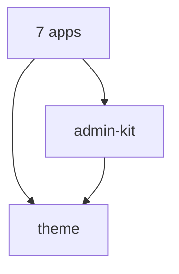

# Case study: Blingg Platform

## Overview
Blingg is a fintech product with savings groups. This repo holds all of its web surfaces: the public marketing site and six staff consoles for finance, compliance, support, community, security and super admin.

## The problem
Staff in different teams need very different tools, and a support agent should never load or reach the security console. One big admin app would mix all of that code and access together.

## What I built
- A pnpm monorepo with seven apps and three shared packages
- `@blingg/admin-kit`: one shell, auth guard, login screen and table set shared by every console
- `@blingg/theme`: shared design tokens and fonts for all seven apps
- A shared ESLint config that blocks one app from importing another
- The marketing site with a blog, FAQ, legal pages, waitlist and a partner portal

## How it works
React 19, React Router 7, Vite 7 and Tailwind CSS 4. Each console is roughly a domain file, a routes array and its pages, mounted by `<AdminApp>` from admin-kit. Packages are used as source, so there is no package build step. Each app deploys as its own Vercel project.

## Challenges and how I solved them
- **Isolation without copy and paste.** Splitting into six apps means duplication, so the shared admin-kit holds it.
- **Separate sessions.** Sessions are namespaced per console, so signing into finance does not sign you into security.
- **Refresh on deep links.** Each app has a `vercel.json` rewrite to `index.html` so client routes survive a reload.

## Outcome
The marketing site is live and every app deploys on its own through Vercel, with CI on lint and build. Console data is mocked for now and ready to swap for an API layer. <!-- add real metric if available -->

## Links
- Live: www.blinggapp.com
- Code: github.com/emmybest19/blinggs-web-app
